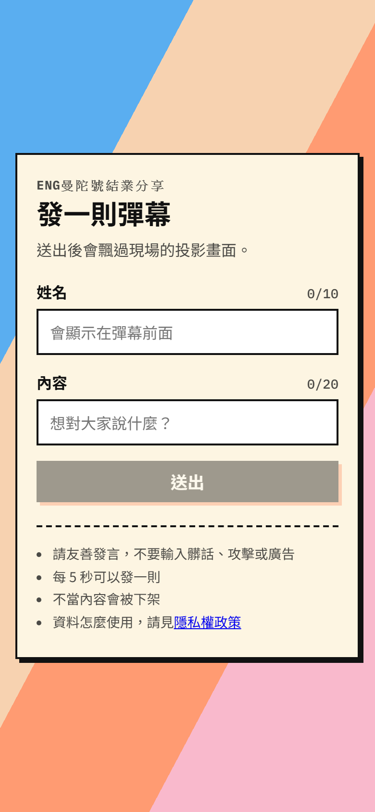
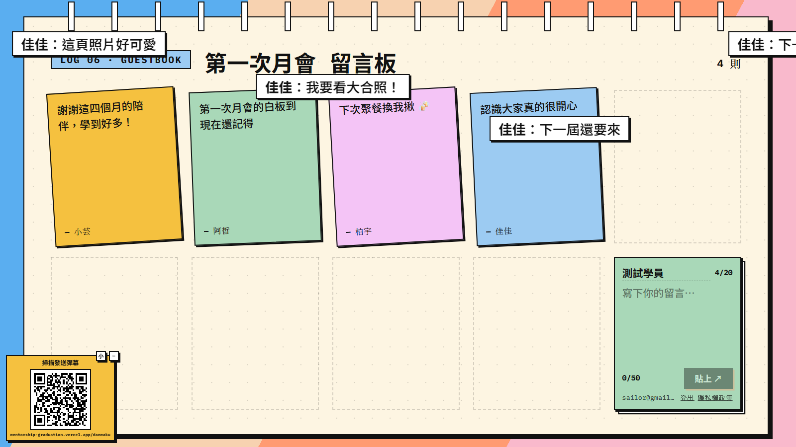
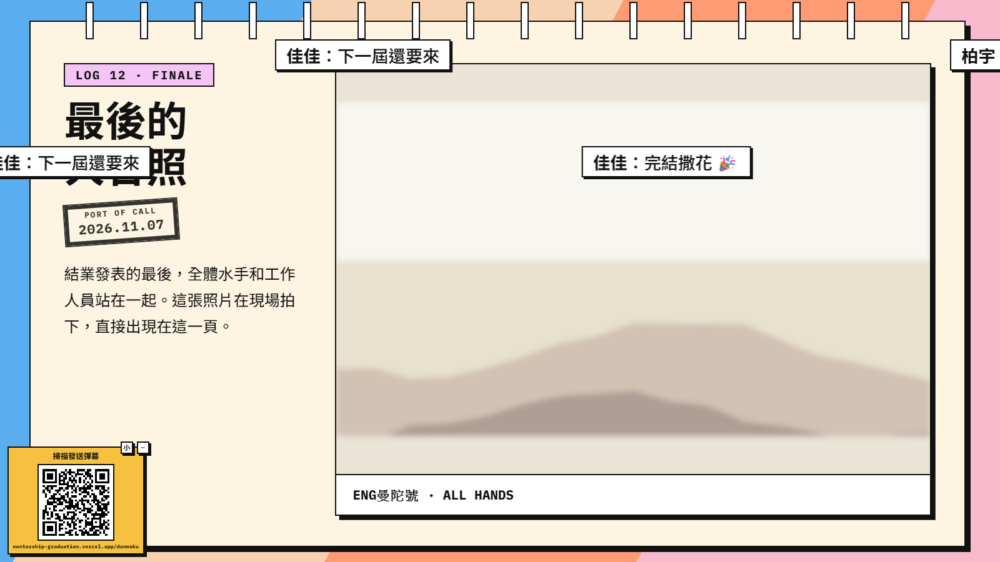
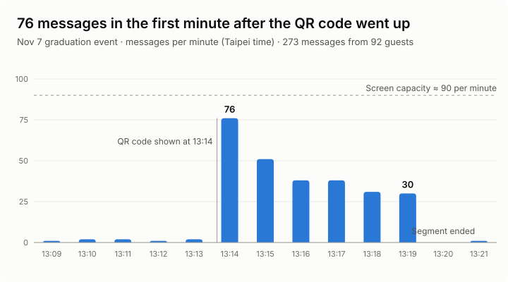
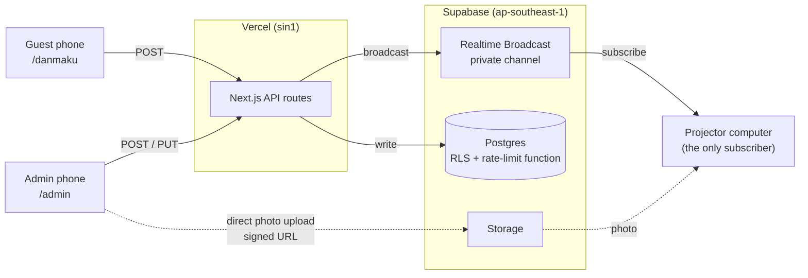

# ENG Mentorship Graduation Showcase

[中文](README.md) | **English**

**A page-flipping "ship's log" website projected live on stage. Guests scan a QR code with their phones, and their messages fly across the projector screen in real time.**

**Live demo: [mentorship-graduation-demo.vercel.app](https://mentorship-graduation-demo.vercel.app)** (mock mode: mentees, staff and photos are replaced with fake data, and the live messages are auto-generated. Press F for full screen; flip pages with the arrow keys or the mouse wheel.)

ENG曼陀號 ("ENG Mentor Ship") is a four-month mentorship program for engineers with 22 mentees. This website was the main stage of its graduation event on November 7, 2026: it looked back on the four-month voyage, let the audience interact in real time, and put the closing group photo straight onto the projector screen.

https://github.com/user-attachments/assets/22d64f22-341e-4edd-815b-3ee0aed32f5e

| 273 messages | 92 guests took part | Peak of 76 per minute | 0 failures on the day |
| :----------: | :-----------------: | :-------------------: | :-------------------: |

## Features

<table>
<tr>
<td width="30%"></td>
<td>

### Live on-screen messages

Guests scan the QR code in the bottom-left corner of the projector screen, enter a nickname and a short message (up to 20 characters) on their phone, and it immediately flies across the screen.

- Rate-limited in Postgres: 1 message every 5 seconds and 20 every 10 minutes per guest
- Filters profanity and links, including disguised variants (full-width characters, zero-width characters, etc.)
- Admins can pause all messages with one tap or take down a single message, which disappears from the screen in real time

</td>
</tr>
</table>

<table>
<tr>
<td width="50%"></td>
<td width="50%"></td>
</tr>
<tr>
<td>

### Monthly meetup guestbook

Each of the four monthly meetups has its own wall of sticky notes; a new note flies to an empty spot and "sticks" there. Only ENG members can post: they sign in with Google, their email must be on an allowlist, and posting is opened and closed from the admin panel.

</td>
<td>

### Live group photo reveal

When the group photo is taken at the end of the event, an admin taps "Take & upload photo" on their phone, and the projector switches to the photo with a darkroom-style developing animation. [How it works (in Chinese) →](docs/portfolio/group-photo.md)

</td>
</tr>
</table>

Also included: a 16:9 page-flip engine (mouse wheel, arrow keys and presentation clickers all work), "sailor ID" cards and profiles for each mentee, and an admin panel.

## On the day

- **68% of participants (63 of 92) sent a message within the first minute after the QR code went up.**
- **The expected bottleneck never showed up.** The load tests mainly guarded against "everyone on the venue Wi-Fi, sharing one IP", but on the day the 92 guests came from 90 different IPs. Both scenarios had been tested beforehand, so the system stayed within expectations: Realtime peaked at about 12 events per second, roughly 12% of the free-tier limit.
- **What came close to its limit was the projector screen, not the backend.** The peak of 76 messages per minute was 84% of what the screen can show (about 90 per minute).

Full data and analysis: [Event stats (in Chinese)](docs/portfolio/event-stats.md)

## Architecture

Every table write goes through the API; browsers have no write access to any table. The group photo file skips the API: the admin's phone gets a signed upload URL from the API and uploads straight to Storage ([flow, in Chinese](docs/portfolio/group-photo.md)). The projector only receives updates through Realtime.

## Technical decisions

**Real-time push: Supabase Realtime Broadcast, and only the server can publish.**
Vercel is serverless and can't hold long-lived WebSocket connections, so real-time push is handled by Supabase. I chose Broadcast over Postgres Changes because the latter checks permissions for every subscriber on every change. The channel is private, and RLS lets browsers receive but not send, so even someone holding the public anon key can't flood the projector screen directly.
→ [`supabase/migrations/…_realtime.sql`](supabase/migrations/20261022000003_realtime.sql), [`lib/realtime.ts`](lib/realtime.ts)

**Only the projector computer subscribes to Realtime.**
Anyone can flip through the book and read the guestbook (only allowlisted ENG members can post), but only the projector computer, which opens `/?key=<SCREEN_KEY>` and receives a signed cookie (HMAC, expires after 48 hours), subscribes. That keeps the free tier's connection and message quotas for the screen that actually needs them.
→ [`lib/screen-gate.ts`](lib/screen-gate.ts)

**Rate limiting lives in a Postgres function.**
Serverless functions can't keep counters in memory, so "lock this guest → check their recent messages → insert only if allowed" happens in a single transaction. A double tap can't send an extra message.
→ [`supabase/migrations/…_post_functions.sql`](supabase/migrations/20261022000002_post_functions.sql)

**Message IDs follow commit order, so the polling fallback never misses one.**
When the projector loses its connection, it polls `GET /api/danmaku?since=<last id>` every 3 seconds. But identity IDs are assigned at insert time while transactions may commit in a different order, so the polling cursor could skip a message that hasn't committed yet. The fix is to take a global advisory lock before inserting and hold it until commit, so IDs are generated in the order they become visible.
→ [`supabase/migrations/…_danmaku_commit_order.sql`](supabase/migrations/20261022000005_danmaku_commit_order.sql), [`lib/hooks/useDanmakuStream.ts`](lib/hooks/useDanmakuStream.ts)

**Load testing found problems before the event.**
I wrote a load-test script simulating 300 guests and ran it against a preview environment. It revealed that Vercel functions ran in US East by default while Supabase was in Singapore, so every message traveled halfway around the world. Moving the functions to Singapore cut the p50 send latency from 1.3 s to 137 ms. The results also led to the decision to have only one projector subscribe on the day.
→ [`scripts/loadtest/`](scripts/loadtest/)

**Interfaces and a mock mode designed for parallel development.**
The zod schemas, Broadcast events and hook interfaces were defined and frozen first, then a `NEXT_PUBLIC_USE_MOCK=1` mock mode was added (fake API, fake real-time events, and disconnects you can simulate from the console). Frontend work didn't have to wait for the backend or connect to Supabase. Each issue listed the files it owned, to reduce several people editing the same file at once.
→ [`lib/schemas.ts`](lib/schemas.ts), [`lib/mock/`](lib/mock/)

## My role

I was the lead developer on this project: I wrote the [requirements spec (in Chinese)](docs/spec.md), split the work into 31 issues, set up the development workflow, and did most of the implementation (34 of the 42 merged PRs), including the page-flip engine, the Supabase backend and API, live messages, the guestbook and Google sign-in, the admin panel, group photo upload and reveal, and load testing.

Teammates built the phone message page, the Final projects page, and the staff and mentee lists and photos; the "only the projector subscribes to Realtime" design was also proposed by a teammate.

Development period: October 21 – November 7, 2026

## Tech stack

Next.js 16 (App Router) · React 19 · TypeScript · zod · Supabase (Postgres, Realtime Broadcast, Storage, Auth) · Vercel · GitHub Actions (lint, typecheck, tests, Prettier, build)

## Documentation

The documents below are written in Chinese.

| Document                                                 | Contents                                                           |
| -------------------------------------------------------- | ------------------------------------------------------------------ |
| [Event stats](docs/portfolio/event-stats.md)             | Message data from Nov 7, load-test estimates vs. actual results    |
| [Live group photo reveal](docs/portfolio/group-photo.md) | How the on-site photo gets to the projector, and its safeguards    |
| [Requirements spec](docs/spec.md)                        | Features, tables, API and Realtime design                          |
| [Development guide](docs/development.md)                 | Local development, Supabase setup, team workflow                   |
| [Load testing](scripts/loadtest/README.md)               | How the load tests work and how to read the results                |
| [Visual reference](docs/flipbook-demo.html)              | Prototype of page flipping and interactions (open it in a browser) |
