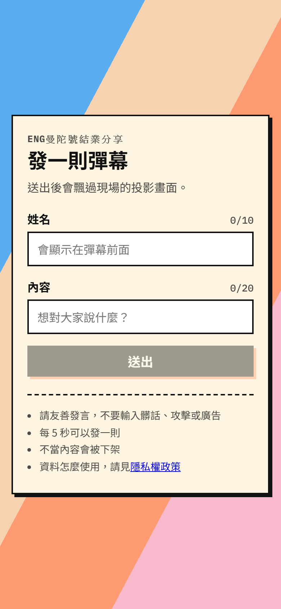
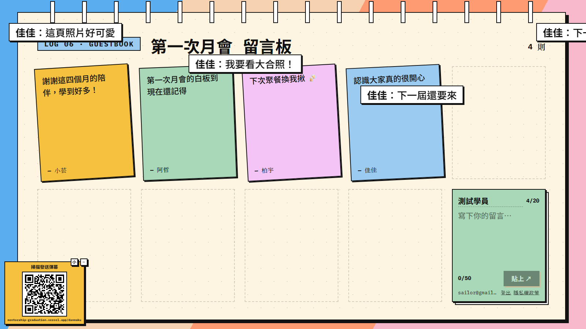
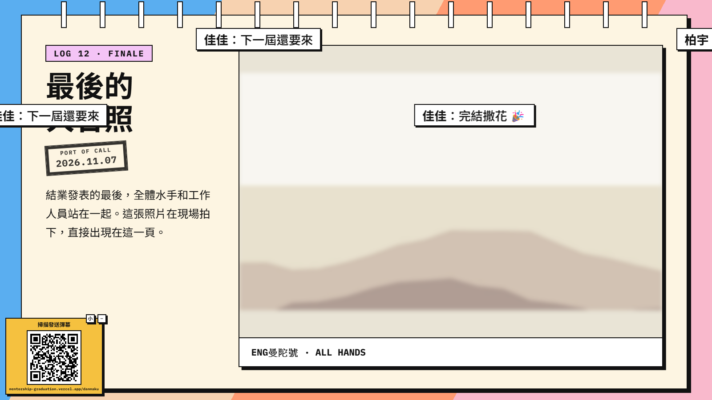
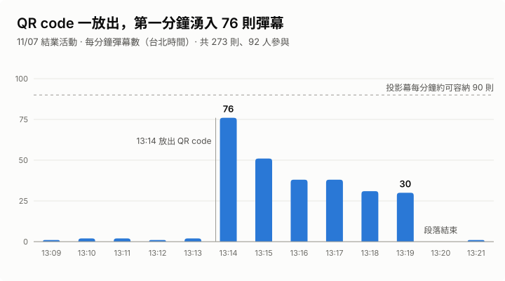
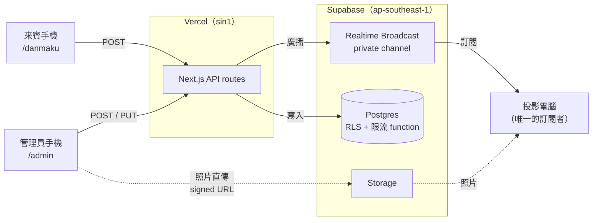

# ENG曼陀號結業分享

**一本在現場投影的翻頁「航海日誌」網站。來賓用手機掃 QR code，彈幕就會即時飄過投影幕。**

ENG曼陀號是一個為期四個月的工程師 mentorship 計畫，共 22 位學員。這個網站是 2026/11/07 結業發表的主舞台：回顧四個月的航程，讓現場來賓即時互動，最後拍下的大合照也直接出現在投影幕上。

<!-- TODO：介紹影片。上傳到 GitHub 後，把 https://github.com/user-attachments/assets/... 網址單獨放在這一行 -->

| 273 則彈幕 | 92 位來賓參與 | 尖峰每分鐘 76 則 | 當天 0 失誤 |
| :--------: | :-----------: | :--------------: | :---------: |

## 功能

<table>
<tr>
<td width="30%"></td>
<td>

### 即時彈幕

來賓掃投影幕左下角的 QR code，在手機上輸入暱稱和一句話（最多 20 字），送出後立刻飄過投影幕。

- 每人每 5 秒 1 則、每 10 分鐘 20 則，在 Postgres 裡限流
- 過濾髒話與連結（含全形字、零寬字元等變形）
- 管理員可以在後台一鍵暫停全部彈幕，或下架單則，投影幕即時移除

</td>
</tr>
</table>

<table>
<tr>
<td width="50%"></td>
<td width="50%"></td>
</tr>
<tr>
<td>

### 月會留言板

四次月會各有一面便條紙牆，送出時便條會飛到空位「黏上」。只有 ENG 夥伴能留言：用 Google 登入，email 要在白名單裡，開放期間由後台開關控制。

</td>
<td>

### 大合照即時顯影

活動最後拍下大合照，管理員在手機上按「拍照上傳」，投影幕就換上照片，並播放像暗房一樣的顯影動畫。[怎麼做的 →](docs/portfolio/group-photo.md)

</td>
</tr>
</table>

另外還有：16:9 翻頁引擎（滾輪、方向鍵、簡報筆都能翻頁）、學員「水手證」卡片與個人檔案、管理後台。

## 活動當天

- **QR code 放出後的第一分鐘，68% 的參與者（63/92 人）就送出了彈幕。**
- **原本預期的瓶頸沒有發生。** 壓測主要防範「全場共用 Wi-Fi、同一個 IP」，但當天 92 位來賓來自 90 個不同的 IP。兩種情境活動前都測過，所以系統都在預期範圍內：Realtime 尖峰約每秒 12 個事件，大約是免費方案上限的 12%。
- **真正接近上限的是投影幕，不是後端。** 尖峰每分鐘 76 則，已經到投影幕容量（約 90 則）的 84%。

完整數據與分析：[活動數據](docs/portfolio/event-stats.md)

## 架構

所有寫入都經過 API，瀏覽器沒有任何資料表的寫入權限；投影端只透過 Realtime 接收。

## 技術上的決策

**即時推播：Supabase Realtime Broadcast，而且只有伺服器能發送。**
Vercel 是 serverless，無法維持 WebSocket 長連線，所以即時推播交給 Supabase。選 Broadcast 而不是 Postgres Changes，是因為後者每筆變更都要對每個訂閱者檢查權限。頻道設為 private，用 RLS 讓瀏覽器只能接收、不能發送，就算有人拿到公開的 anon key，也沒辦法直接對投影幕洗版。
→ [`supabase/migrations/…_realtime.sql`](supabase/migrations/20261022000003_realtime.sql)、[`lib/realtime.ts`](lib/realtime.ts)

**只讓投影電腦訂閱 Realtime。**
任何人都能翻書、留言，但只有開過 `/?key=<SCREEN_KEY>`、拿到簽章 cookie（HMAC，48 小時到期）的投影電腦會訂閱，免費方案的連線數和訊息量都留給真正需要的螢幕。
→ [`lib/screen-gate.ts`](lib/screen-gate.ts)

**限流寫在 Postgres function 裡。**
serverless function 無法在記憶體裡保留計數器，所以把「鎖住這位來賓 → 查最近的彈幕 → 通過才寫入」放在同一個交易裡完成，連點兩下也不會多送一則。
→ [`supabase/migrations/…_post_functions.sql`](supabase/migrations/20261022000002_post_functions.sql)

**彈幕 id 依 commit 順序產生，斷線時改用輪詢也不會漏。**
投影端斷線時，每 3 秒用 `GET /api/danmaku?since=<最後一則的 id>` 輪詢。但 identity id 是在寫入時分配的，交易卻可能以不同順序 commit，輪詢的游標可能跳過還沒 commit 的那一則。解法是在寫入前取得一把全域 advisory lock，持有到 commit 為止，讓 id 依可見的順序產生。
→ [`supabase/migrations/…_danmaku_commit_order.sql`](supabase/migrations/20261022000005_danmaku_commit_order.sql)、[`lib/hooks/useDanmakuStream.ts`](lib/hooks/useDanmakuStream.ts)

**活動前用壓測找出問題。**
寫了模擬 300 位來賓的壓測腳本，在 preview 環境實測。結果發現 Vercel function 預設跑在美東、Supabase 在新加坡，每則彈幕都要繞半個地球；把 function 移到新加坡後，送出延遲的 p50 從 1.3 秒降到 137 ms。也依壓測結果決定活動當天只開 1 台投影機訂閱。
→ [`scripts/loadtest/`](scripts/loadtest/)

**為多人並行開發設計的介面與 mock 模式。**
先定好 zod schemas、Broadcast 事件和 hooks 的介面並凍結，再加上 `NEXT_PUBLIC_USE_MOCK=1` 的 mock 模式（假 API、假的即時事件、可以在 Console 模擬斷線），前端不用等後端，也不用連 Supabase 就能開發。每個 issue 列出負責的檔案，減少多人同時修改同一個檔案。
→ [`lib/schemas.ts`](lib/schemas.ts)、[`lib/mock/`](lib/mock/)

## 我的角色

我是這個專案的主要開發者：撰寫[需求規格書](docs/spec.md)、拆分 31 個 issue、建立開發流程，並負責大部分的實作（合併的 42 個 PR 中有 34 個），包括翻頁引擎、Supabase 後端與 API、即時彈幕、留言板與 Google 登入、管理後台、大合照上傳與顯影，以及壓測。

團隊夥伴負責了手機彈幕送出頁、Final 專案頁、工作人員與學員名單和照片；「只讓投影電腦訂閱 Realtime」的規格也是由夥伴提出的。

開發期間：2026/10/21 – 11/07

## 技術棧

Next.js 16（App Router）· React 19 · TypeScript · zod · Supabase（Postgres、Realtime Broadcast、Storage、Auth）· Vercel · GitHub Actions（lint、typecheck、測試、Prettier、build）

## 文件

| 文件                                            | 內容                                  |
| ----------------------------------------------- | ------------------------------------- |
| [活動數據](docs/portfolio/event-stats.md)       | 11/07 彈幕數據、壓測預估和實際的對照  |
| [大合照即時顯影](docs/portfolio/group-photo.md) | 現場拍照上傳到投影幕的流程與防呆設計  |
| [需求規格書](docs/spec.md)                      | 功能、資料表、API、Realtime 設計      |
| [開發指南](docs/development.md)                 | 本機開發、Supabase 設定、團隊開發流程 |
| [壓力測試](scripts/loadtest/README.md)          | 壓測方式與結果怎麼看                  |
| [視覺參考](docs/flipbook-demo.html)             | 翻頁與互動的原型（用瀏覽器直接開啟）  |
