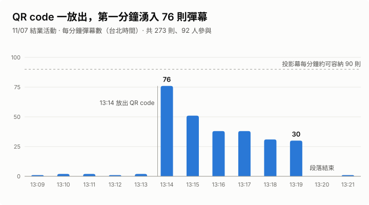

# 活動數據：11/07 結業發表的彈幕

2026/11/07 結業發表當天，網站在現場投影，來賓用手機掃 QR code 發彈幕。以下數字來自正式環境的資料庫，查詢寫在 [`scripts/stats/event-stats.sql`](../../scripts/stats/event-stats.sql)。

## 重點數字

| | |
| --- | --- |
| 彈幕總數 | **273 則**（後台沒有隱藏任何一則） |
| 參與人數 | **92 人**，來自 90 個不同的 IP |
| 主要時段 | 13:14–13:19，6 分鐘內 264 則 |
| 最忙的一分鐘 | **76 則**，63 人（13:14，QR code 剛放出來） |
| 最忙的 10 秒 / 1 秒 | 31 則 / 6 則 |
| 每人發送數 | 中位數 2 則，平均 2.97 則，最多 19 則 |
| 留言板 | 21 則（公開 19 則，隱藏 2 則），10 位成員，第一到第四次月會各 5 / 2 / 5 / 7 則 |
| 當天狀況 | **0 失誤**：彈幕和現場大合照上傳（[怎麼做的](group-photo.md)）都一次成功 |

## 時間軸怎麼解讀

- **13:09–13:13 暖場**：每分鐘 1–2 則。
- **13:14 放出 QR code**：第一分鐘就有 63 人送出彈幕，佔全部參與者的 68%。最忙的 10 秒在 13:14:40 開始，共 31 則。
- **13:15–13:19 逐漸趨緩**：每分鐘 51 → 38 → 38 → 31 → 30 則，到最後一分鐘還有 22 人在送。
- **13:20 段落結束**，彈幕也跟著停止。

尖峰的每分鐘 76 則，大約是投影幕容量（每分鐘約 90 則）的 84%。

## 參與分布

| 每人發送數 | 人數 |
| --- | --- |
| 1 則 | 42 人（46%） |
| 2–3 則 | 27 人 |
| 4–5 則 | 10 人 |
| 6–10 則 | 9 人 |
| 11–20 則 | 4 人 |

將近一半的人只送一則，少數人很投入。同一人連續兩則之間的間隔，中位數是 39.4 秒。

## 壓測預估 vs 實際

活動前用 [`scripts/loadtest/danmaku.mjs`](../../scripts/loadtest/danmaku.mjs) 模擬 300 人做過壓測（#21）。

| | 壓測的預估 | 活動當天 |
| --- | --- | --- |
| 來賓的網路 | 主要情境：全場共用 Wi-Fi、同一個對外 IP。這時 93% 的送出會被 IP 限流擋下（每個 IP 每分鐘 120 則） | **92 人有 90 個不同的 IP**，最多的一個 IP 只佔 7%。大家幾乎都用手機網路 |
| 每個 IP 每分鐘最多 | 上限 120 則 | **9 則** |
| 最忙的一秒 | preview 環境 12–15 則；本機模擬「每人不同 IP」時 46 則 | **6 則** |
| Realtime 事件量（最忙的一秒 ×（1 + 投影機數）） | 2 台投影機時 39–45 個/秒；最壞情境 46 ×（1 + 1）= 92 個/秒（免費方案上限 100） | 1 台投影機：6 ×（1 + 1）= **約 12 個/秒** |
| 個人限流（每 5 秒 1 則、每 10 分鐘 20 則） | — | 181 次連續發送中，只有 7 次間隔落在 5–6 秒（剛等完倒數就再送）；**沒有人碰到 10 分鐘 20 則的上限** |

### 學到的事

1. **原本預期的瓶頸沒有發生。** 壓測主要防範的是「全場共用一個 IP」，但實際上來賓幾乎都用手機網路。當天的狀況比較接近只能在本機測的「每人不同 IP」情境。兩種情境活動前都測過，所以不論哪一種，系統都在預期範圍內。
2. **「只讓 1 台投影機訂閱」的保守決定有餘裕。** 這是依最壞情境（92 個/秒，接近 100 的上限）做的決定，當天實際只用到上限的 12% 左右。
3. **限流幾乎沒被觸發，但不代表沒必要。** 正常來賓的節奏（間隔中位數約 40 秒）離限流很遠；限流的作用是防止有人洗版，而當天也沒有需要隱藏的彈幕。
4. **投影幕容量才是真正接近上限的地方。** 尖峰每分鐘 76 則，已經到投影幕容量的 84%。如果來賓更多，先遇到的限制會是畫面放不下，而不是後端撐不住。

## 資料說明

- 範圍：2026/11/07 13:00–14:00（台北時間）。活動前的測試資料（10/23、11/04、11/06，以及 11/07 早上）和壓測資料都已排除。
- 被限流擋下的請求不會寫進資料庫，所以上面只能用「間隔 5–6 秒」和「碰到 20 則上限的人數」間接推估限流的狀況，沒有實際被擋下的次數。
- Realtime 事件量是依送出時間推算，不是 Supabase 報表上的實測值。
- 這裡只列統計數字。彈幕的暱稱、`client_id`、`ip_hash` 和留言者的帳號都沒有離開資料庫。

## 原始數據：每分鐘彈幕數

| 時間 | 彈幕 | 發送人數 | 累計 |
| --- | --- | --- | --- |
| 13:09 | 1 | 1 | 1 |
| 13:10 | 2 | 2 | 3 |
| 13:11 | 2 | 2 | 5 |
| 13:12 | 1 | 1 | 6 |
| 13:13 | 2 | 2 | 8 |
| 13:14 | 76 | 63 | 84 |
| 13:15 | 51 | 34 | 135 |
| 13:16 | 38 | 26 | 173 |
| 13:17 | 38 | 26 | 211 |
| 13:18 | 31 | 22 | 242 |
| 13:19 | 30 | 22 | 272 |
| 13:20 | 0 | 0 | 272 |
| 13:21 | 1 | 1 | 273 |
