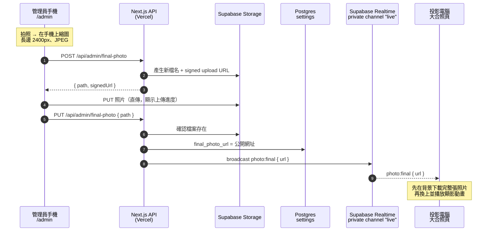

# 大合照：現場拍照，投影幕即時「顯影」

結業發表的最後，全體水手和工作人員拍下大合照。管理員在手機的後台按「拍照上傳」，投影幕上的大合照頁就換上這張照片，並播放像暗房顯影一樣的動畫：照片從一片泛白、模糊，慢慢浮現出顏色。活動當天一次成功，沒有任何失誤。

這篇說明它是怎麼做的，以及為了確保當天不出錯，做了哪些防呆設計。

## 整體流程



## 一步一步拆解

### 1. 在手機上先縮圖

手機拍的原圖動輒好幾 MB，現場網路又不一定穩。所以上傳前先在瀏覽器裡用 canvas 把照片縮到長邊 2400px，再轉成 JPEG（品質 0.85）。投影幕的解析度用不到更大的照片。

讀圖時用 `createImageBitmap(file, { imageOrientation: "from-image" })`，套用照片 EXIF 裡的旋轉資訊，**手機直拍的照片才不會在投影幕上躺著**。

> 程式碼：[`app/admin/PhotoUpload.tsx`](../../app/admin/PhotoUpload.tsx) 的 `shrink()`

### 2. 照片直傳 Storage，不經過 serverless function

Vercel function 的請求內容有大小上限（只有幾 MB），照片如果經過 API，很容易被擋下。所以改成三步：

1. 手機先向 API 要一張「上傳許可」：API 產生一個新的檔名，例如 `final-1762492800000-a1b2c3d4.jpg`，再用 service role 向 Storage 要一個只能上傳這個檔名的 **signed upload URL**。
2. 手機拿這個 URL，**直接把照片 PUT 到 Storage**。這裡刻意用 `XMLHttpRequest` 而不是 `fetch`，因為 `fetch` 拿不到上傳進度，XHR 的 `upload.onprogress` 可以讓後台顯示「上傳中 63%」。
3. 上傳完成後，手機再通知 API「照片在這個 path」。

Storage bucket 沒有開放任何 anon 寫入權限，**只有拿到 signed URL 的人能上傳，而只有登入後台的管理員才拿得到**。

> 程式碼：[`app/api/admin/final-photo/route.ts`](../../app/api/admin/final-photo/route.ts)、[`supabase/migrations/20261022000004_storage.sql`](../../supabase/migrations/20261022000004_storage.sql)

### 3. API 驗證後寫入設定，再廣播

API 收到 path 後：

1. 用 zod 檢查 path 符合 `final-<13 位時間戳>-<8 位 hex>.jpg` 的格式，任何其他檔名一律拒絕。
2. 確認 Storage 裡真的有這個檔案。
3. 把照片的公開網址寫進 `settings.final_photo_url`，讓之後打開網站的人也看得到。
4. 透過 Realtime 的 REST API 送出 `photo:final { url }` 事件。

**每次上傳都用新的檔名**，所以檔案內容永遠不會變，可以設一年的快取。也因為網址每次都不同，瀏覽器和 CDN 不會拿舊照片充數。

### 4. 只有伺服器能對投影幕廣播

投影電腦訂閱的是 Supabase Realtime 的 **private channel** `live`，權限用 RLS 寫在 `realtime.messages` 上：

```sql
create policy "anyone can receive live broadcasts"
on realtime.messages for select to anon, authenticated
using (realtime.topic() = 'live' and realtime.messages.extension = 'broadcast');
```

只有 `select`（接收），沒有 `insert`（發送）。anon key 本來就是公開的，任何人都能從網頁裡找到，但**拿著它也無法對投影幕送出假的照片或彈幕**。只有伺服器用 service role 才能發送。

投影端收到事件時，也會用和伺服器同一份 zod schema 驗證 payload，格式不對就丟掉。

> 程式碼：[`supabase/migrations/20261022000003_realtime.sql`](../../supabase/migrations/20261022000003_realtime.sql)、[`lib/supabase/broadcast.ts`](../../lib/supabase/broadcast.ts)、[`lib/realtime.ts`](../../lib/realtime.ts)

### 5. 下載完才換上，換上的那一刻開始顯影

投影端收到新網址後，不會立刻換掉 ``，而是先用 `new Image()` 在背景下載。**整張照片下載完成才換上**，投影幕上不會出現載到一半的照片。

換上之後，在畫面繪製前（`useLayoutEffect`）用 Web Animations API 播放 3.2 秒的顯影動畫：

```ts
const DEVELOP: Keyframe[] = [
  { filter: "brightness(2.6) saturate(0) blur(6px)", opacity: 0.2 }, // 剛放進顯影液：泛白、沒有顏色、模糊
  { opacity: 1, offset: 0.4 },
  { filter: "brightness(1) saturate(1) blur(0)", opacity: 1 },       // 影像完全浮現
];
```

幾個細節：

- 只有「頁面打開之後才到的照片」會顯影；重新整理頁面時，原本就有的照片直接顯示。
- 照片到的時候如果投影幕停在別頁，會等翻到大合照頁才開始顯影，不會在沒人看的時候播掉。
- 系統開啟「減少動態效果」時不播動畫。

> 程式碼：[`components/pages/GroupPhoto.tsx`](../../components/pages/GroupPhoto.tsx)

## 為什麼當天能 0 失誤：防呆設計

現場只有一次機會，所以每一個可能出錯的地方都先想好了退路：

| 可能發生的狀況 | 怎麼處理 |
| --- | --- |
| 上傳的瞬間，投影電腦的 Realtime 剛好斷線 | 斷線期間，投影端每 5 秒向 API 重抓一次設定；重新連上時也會再抓一次。照片寫在資料庫裡，不會因為錯過廣播就消失 |
| 廣播送不出去 | 照片網址已經寫進資料庫，廣播失敗不會讓上傳失敗；投影端靠上面的輪詢或重新整理補上 |
| 上傳到一半網路斷掉 | 縮好的照片留在手機上，按「重試上傳」即可，不用重拍 |
| 新照片在投影端下載失敗 | 保留上一張照片，並標示「新照片載入失敗，目前顯示的是上一張」，避免大家誤以為那就是新照片 |
| 瀏覽器或 CDN 快取到舊照片 | 每次上傳都用新的檔名 |
| 手機直拍的照片方向不對 | 縮圖時套用 EXIF 旋轉 |
| 彩排時上傳了測試照片 | 後台有「清除大合照」，投影幕回到「等待合照上傳中…」（#64）；清除前會再確認一次 |
| 有人拿公開的 anon key 對投影幕亂送 | Realtime channel 用 RLS 限制只能接收；Storage 只接受 signed URL 上傳 |

## 設計上的取捨

- **用 Broadcast，不用 Postgres Changes。** Postgres Changes 每筆變更都要對每個訂閱者檢查權限，人多就慢；Broadcast 由伺服器在寫入成功後主動發送，事件內容也由我們決定。
- **只有投影電腦訂閱 Realtime。** 投影電腦開一次 `/?key=...` 取得 cookie 後才會訂閱，一般訪客只在打開頁面時抓一次資料，不佔 Realtime 連線數。
- **Vercel function 放在新加坡（`sin1`），和 Supabase 同區。** 壓測時發現 function 原本在美東，每次 API 呼叫都要繞半個地球。改到同區後，彈幕送出延遲從 p50 1.3 秒降到 137 ms，大合照的 API 呼叫也受惠。

## 相關 PR

- #48：大合照上傳（手機拍照、縮圖、signed URL 上傳、即時換上投影）
- #49：大合照頁與顯影動畫
- #65：後台新增「清除大合照」按鈕（#64）
