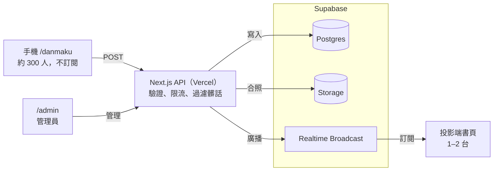
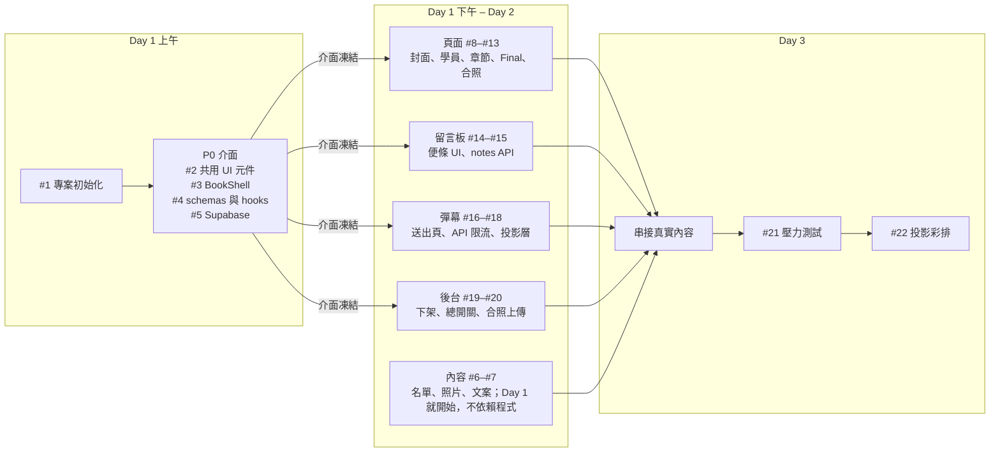

# ENG曼陀號結業分享 — 需求規格書

> 這份是專案的需求規格書正本，有異動請直接發 PR 修改。視覺與互動參考見 [`flipbook-demo.html`](flipbook-demo.html)。

## 1. 專案概述

11/07（六）結業發表當天，我們會在現場投影一本可以翻頁的「航海日誌」網站，回顧這 4 個月的航程。來賓用手機掃 QR code 就能發彈幕，彈幕會即時飄過投影畫面。團隊有 3–5 人，開發期 3 天。

| 項目 | 內容 |
| --- | --- |
| 網站名稱 | ENG曼陀號結業分享 |
| 發表日期 | 11/07 Sat. |
| 主畫面 | 現場投影（16:9），由工作人員用滾輪、方向鍵或簡報筆操作 |
| 來賓互動 | 手機掃 QR code 進入彈幕頁，輸入姓名和內容後送出；留言板限 ENG 夥伴用 Google 登入後在書頁上填寫（見 3.1） |
| 預估同時在線 | 約 300 人發彈幕；訂閱即時訊息的只有投影端 1–2 台 |
| 活動後 | 網站繼續公開，但加上 `noindex`，不讓搜尋引擎收錄；留言板繼續開放，之後封存成唯讀（見 3.6） |

**不在本次範圍內：** 手機版的完整翻書體驗（手機能看就好，不另外優化）。

## 2. 頁面結構與內容需求

書一共有 13 個章節，每個章節都是一個獨立的頁面元件。有留言板的章節，後面會自動接上留言板頁；留言超過一頁時會自動增加頁數。照片和文案一律放在 repo 的 `content/` 資料夾。

| # | 章節 | 內容 | 留言板 | 備註 |
| --- | --- | --- | --- | --- |
| 01 | 封面 | 標題「ENG曼陀號結業分享」、日期 11/07 Sat.、主視覺圖 | 無 |  |
| 02 | 工作人員 | 身份（船長、引水人、助教、客座講師…）、姓名、一句介紹 | 無 | 名單待提供；人數多時拆成 2 頁 |
| 03 | 學員介紹 | 24 位學員（4 位航海士、20 位水手）的姓名、身分和頭像；點擊會跳出「水手檔案」彈窗，顯示座右銘和 LinkedIn | 無 | 照片和 LinkedIn 非必填；沒有照片的人用插畫或動畫頭像；24 人分 2 頁，每頁 12 位 |
| 04 | 海選 | 流程（步驟式）、一小段文字、1–2 張照片 | 無 | 文字精簡，快速帶過 |
| 05 | 相見歡 | 照片分享 | 無 |  |
| 06 | 第一次月會 | 主題「卓越軟體工程師的知識管理與 AI 賦能」，大綱和照片 | 有 |  |
| 07 | 第二次月會 | 主題「現代軟體工程範式：測試驅動與 AI 協同開發」，大綱和照片 | 有 |  |
| 08 | 第三次月會 | 主題「ENG x PM 跨職能協作工作坊」，大綱和照片 | 有 |  |
| 09 | 第四次月會 | 主題「專案發表 x 大型軟體公司職場術：從優秀到卓越工程師」，大綱和照片 | 無 | 留言板接在第 10 章後面 |
| 10 | 第四次月會（Final） | 8 組專案，每組一張圖、專案名稱、QR code 連結 | 有 | QR code 在建置時由 URL 自動產生，不用放圖檔 |
| 11 | 各種小聚 | 月會後聚餐、co-working、COSCUP 的照片 | 無 |  |
| 12 | 大合照 | 現場拍的大合照，上傳後以「顯影」動畫出現 | 無 | 只有管理員能上傳，見第 3 節 |
| 13 | 全站彈幕層 | 不是一頁，而是疊在所有頁面上的彈幕，加上右下角懸浮的 QR code | — | 見第 3 節 |

**各頁共通需求：**

- 左上角工具列可以跳到任一章節，並顯示頁碼；滑鼠閒置時自動隱藏
- 可用滾輪、↑↓、PageUp/PageDown（簡報筆）翻頁；按 F 全螢幕、D 開關彈幕
- 每頁左側是文字欄（章節標籤、標題、日期，加上一小段文字或大綱），右側是照片或內容
- 照片版型共用同一套模板：hero（1 張）、grid2、grid3（6 張）、mosaic（3 張）
- 學員的身分、照片、座右銘、LinkedIn 來自 `content/sailors.ts`；欄位是空的就不顯示對應元素

## 3. 互動功能規格

互動功能有四個：留言板、彈幕、大合照上傳、管理後台。第一版都不需要登入。

### 3.1 留言板（第 06–09 章）

- 欄位：姓名（必填，最多 20 字）、內容（必填，最多 50 字）。輸入框旁要有即時字數計算，前後端都要驗證字數
- 送出後，便條紙要從輸入框飛到空位並「黏上」：位移、輕微旋轉、落地時彈一下；便條顏色從 4 色中隨機挑一個
- 每頁放 9 張便條，右下角保留給輸入框；留言超過一頁時自動加頁
- 別人新增的留言要即時出現（走 Realtime Broadcast）；只有投影電腦即時更新，一般訪客重新整理後才看到（見 3.5）
- **只有 ENG 夥伴能留言**（#55）：用 Google 登入，email 要在 `allowed_emails` 白名單裡。白名單在 Supabase Dashboard 維護，不放進 repo。任何人都能看留言
  - 未登入時便條紙位置顯示「用 Google 登入」；不在名單內時顯示目前帳號的 email、「換帳號」和「重新確認」
  - 姓名欄預設帶入 Google 名稱，可以修改；每則留言記下作者的 `user_id`，後台看得到作者 email，公開 API 不回傳
  - LINE 等 App 的內建瀏覽器不能用 Google 登入，要提示改用瀏覽器開啟
- **開放期間由後台的「留言開關」控制**（`settings.notes_enabled`，預設關閉）：10/24–10/28 開放夥伴留言，之後關閉，活動當天只展示便條。關閉時便條紙位置顯示「留言已截止」
- 不需要審核；可以隱藏式下架：管理員在後台按下隱藏後，那則留言不再顯示，但資料仍留在 DB（`hidden_at` 欄位）

### 3.2 彈幕

**手機送出頁 `/danmaku`**（掃懸浮 QR code 進入）

- 畫面簡單：標題、姓名欄、內容欄、送出鈕，再加上幾條使用規範
- 欄位：姓名（必填，最多 10 字）、內容（必填，最多 20 字）。姓名存在 `localStorage`，下次不用重打
- 使用規範範例：請友善發言，不要輸入髒話、攻擊或廣告；每 5 秒可以發一則；不當內容會被下架
- 送出後要有回饋（已送出／太快了，請 N 秒後再試／包含不當字詞），按鈕進入倒數
- 這一頁**不訂閱** Realtime，只用 POST 送出，所以不佔用連線數

**投影端彈幕層**

- 彈幕從右往左飄，格式是「姓名：內容」，疊在書頁上，翻頁時不中斷
- 分軌道顯示避免重疊；畫面上同時最多 15 則，其他排隊，排隊超過 50 則時丟掉最舊的
- 工具列和 D 鍵可以開關彈幕
- 右下角懸浮一個 QR code，連到 `/danmaku`，可以收合

### 3.3 大合照上傳

- 只有管理員能上傳（目前由專案負責人負責），入口在 `/admin`，支援手機直接拍照
- 前端先縮小到長邊 2400px 再上傳到 Supabase Storage
- 上傳完成後用 Broadcast 通知投影端，第 12 章即時替換成新照片並播放顯影動畫

### 3.4 管理後台 `/admin`

- 用環境變數 `ADMIN_PASSWORD` 登入，登入後發一個簽章 cookie
- 功能：
  - 彈幕總開關（一鍵暫停或恢復所有彈幕）
  - 留言開關（開放或關閉留言板，見 3.1）
  - 最新 50 則彈幕列表，可單則下架（投影端即時移除）
  - 留言列表，可隱藏／取消隱藏
  - 上傳大合照
  - 編輯髒話詞庫（可留到下一版；第一版先寫在程式裡）

### 3.5 只讓投影電腦訂閱 Realtime

每個訂閱的瀏覽器都佔一條連線。書頁不擋，任何人都能翻書和留言；只有投影電腦訂閱 Realtime、顯示彈幕層和 QR code。

- 投影電腦第一次開 `/?key=<SCREEN_KEY>`，proxy 驗證後發 `screen` cookie（httpOnly，48 小時，值為 `SCREEN_KEY` 的 HMAC），並導回不帶 key 的網址
- 伺服器讀 cookie 後把 `isProjector` 傳給書頁；hooks 只在 `isProjector` 時訂閱，其他人載入時抓一次資料
- key 外流時換掉 `SCREEN_KEY` 重新部署，舊 cookie 就失效

### 3.6 第二階段（活動後再做）

- **封存**：匯出留言（含暱稱）到 `content/archive.json`，用 `NEXT_PUBLIC_DATA_SOURCE=archive` 切成唯讀靜態網站，之後可停用 Supabase。彈幕不留存
- ~~暱稱、Google 綁定~~：改成活動前就做的 Google 登入加白名單（3.1、#55），不再另外做匿名登入和暱稱

## 4. UI 設計風格

風格定為「曼陀號航海日誌 × 新野獸派（neo-brutalism）」，沿用 [`flipbook-demo.html`](flipbook-demo.html) 的粗黑框、硬陰影和上方線圈裝訂，再加入航海元素。所有版面以 16:9 投影為準。

### 4.1 視覺語彙

- **章節標籤**寫成航海日誌格式：`LOG 06 · 卓越工程師`
- **日期旁**加上港口章、海關章造型的戳記
- **照片**用白框加硬陰影，可以做成拍立得或貼在航海圖上的樣子
- **水手卡片**做成「水手證」，點開後的彈窗是「水手檔案」；沒有照片的人用統一風格的插畫頭像（例如船、錨、海鷗）
- **留言板**用點陣紙背景，便條紙略帶旋轉

### 4.2 色彩與字體

| 用途 | 值 |
| --- | --- |
| 線條、文字 | `#111111` |
| 書頁底色 | `#fdf5e2`（米白紙） |
| 強調色 | 鵝黃 `#f5c13f`、薄荷 `#a9d8b8`、粉紅 `#f4c4f6`、天藍 `#9ccbf2` |
| 頁面外背景 | 沿用 demo 的斜向色帶，或改成深海藍。待上投影機比較後決定 |
| 標題字體 | IBM Plex Mono + Noto Sans TC |
| 內文字體 | Noto Sans TC |

字體大小一律用容器單位（`cqw`）並用 `clamp()` 限制上下限，讓書頁放大縮小時文字一起縮放。

### 4.3 投影版面（16:9）

- 書的比例從 demo 的 1.618:1 改成接近 16:9，全螢幕時幾乎填滿投影畫面
- 四邊留白縮小到約 1.5%，上方只留線圈的高度；工具列改為懸浮在書頁上，閒置時自動隱藏，不再佔用上方空間
- 投影時最小內文字級要能在教室最後一排看清楚：Day 3 彩排時實際確認
- 範例已更新在 [`flipbook-demo.html`](flipbook-demo.html)

## 5. 技術架構

前後端都用 Next.js（App Router），部署在 Vercel。Supabase 負責 Postgres、Realtime、Storage，之後再加 Auth。所有寫入都經過 Next.js API route；瀏覽器不直接寫 DB，也不能發 Broadcast。



所有寫入都經過 API，投影端只透過 Realtime 接收。

手機和管理員只呼叫 API；API 寫入 Postgres 後再發廣播，投影端是唯一的訂閱者。書頁載入時的留言和設定，則由 `GET` API 取得。

### 5.1 為什麼不自己架 WebSocket

Vercel 是 serverless，無法維持長連線，所以即時推播交給 Supabase Realtime。我們用的是 **Broadcast**，不是 Postgres Changes，因為 Postgres Changes 每筆變更都要對每個訂閱者檢查權限，人一多就會慢。

- 只有投影端（1–2 台）會訂閱（見 3.5），一般訪客的書頁和手機送出頁都不訂閱。免費方案的上限約是同時 200 條連線、每秒 100 則訊息（開工前請以 [Supabase 官方 pricing](https://supabase.com/pricing) 為準），對這個情境綽綽有餘
- 頻道設為 **private channel**，在 `realtime.messages` 上設 RLS：匿名使用者可以接收（select），不能發送（insert）。只有伺服器用 service role key 透過 REST 發送。這樣可以防止有人拿 anon key 繞過 API 直接對投影幕洗版

### 5.2 資料表

所有資料表都開 RLS，且不給 anon 寫入權限；寫入一律從 API route 用 service role 執行。

| 資料表 | 欄位 | 說明 |
| --- | --- | --- |
| `notes` | `id` uuid, `section` text, `name` text, `body` text, `color` smallint, `client_id` text, `user_id` uuid null, `created_at`, `hidden_at` null | `section` 限定 `m1`–`m4`；用 check constraint 限制 `name` ≤ 20 字、`body` ≤ 50 字；`user_id` 是作者的 Google 登入（`auth.users`），#55 之前的留言是 null |
| `allowed_emails` | `email` text pk, `note` text null, `created_at` | 可以留言的 ENG 夥伴（#55），email 一律小寫；在 Dashboard 維護 |
| `danmaku` | `id` bigint, `name` text, `body` text, `client_id` text, `created_at`, `hidden_at` null | `name` ≤ 10、`body` ≤ 20；建立 `(client_id, created_at)` 索引，給限流查詢用 |
| `settings` | `key` text pk, `value` jsonb | 放 `danmaku_enabled`、`final_photo_url`、`notes_enabled` |

### 5.3 API

請求和回應的格式用 zod 定義在 `lib/schemas.ts`，前後端共用同一份。

| Method | 路徑 | 用途 | 成功後 Broadcast |
| --- | --- | --- | --- |
| GET | `/api/notes?section=m1` | 取得未隱藏的留言 | — |
| POST | `/api/notes` | 新增留言；要帶 `Authorization: Bearer <Google 登入的 access token>`，email 要在白名單（#55） | `note:new` |
| GET | `/api/me` | 目前的 Google 登入是否在白名單（#55） | — |
| POST | `/api/danmaku` | 送出彈幕（含限流和髒話過濾） | `danmaku:new` |
| GET | `/api/settings` | 取得彈幕開關、留言開關和大合照網址 | — |
| POST | `/api/admin/login` | 管理員登入 | — |
| PATCH | `/api/admin/danmaku/[id]` | 下架彈幕 | `danmaku:remove` |
| PATCH | `/api/admin/notes/[id]` | 隱藏／取消隱藏留言 | `note:hide` |
| PUT | `/api/admin/settings` | 彈幕總開關、留言開關 | `settings:update` |
| POST | `/api/admin/final-photo` | 取得上傳用的 signed URL，上傳完成後寫入 `settings` | `photo:final` |

### 5.4 專案結構

```
app/
  page.tsx               ← 書（投影主畫面）
  danmaku/page.tsx       ← 手機送出頁
  admin/page.tsx         ← 管理後台
  api/...                ← 見 5.3
components/
  book/BookShell.tsx     ← 翻頁引擎＋頁面註冊表
  book/pages.ts          ← 頁面註冊表（一頁一行）
  pages/*.tsx            ← 每個章節一個檔案
  guestbook/  danmaku/  ui/
content/                 ← 文案、名單（staff.ts, sailors.ts, sections.ts, projects.ts）
public/photos/<section>/ ← 照片
lib/  supabase/  realtime.ts  schemas.ts  ratelimit.ts  profanity.ts
supabase/migrations/
```

### 5.5 noindex

用兩層設定讓搜尋引擎不收錄：根 layout 的 `metadata.robots = { index: false, follow: false }`，以及 `next.config` 對全站加上 `X-Robots-Tag: noindex` header。`robots.txt` 不要寫 `Disallow`，否則爬蟲讀不到 noindex，反而可能只收錄網址。

## 6. 防洗版與內容安全

限流以「簽章 cookie 中的匿名 ID」為單位，不以 IP 為單位，因為現場 300 人連同一個 Wi-Fi，IP 都一樣。最後一道防線是管理員的彈幕總開關。

### 6.1 匿名 ID（cookie）

- 第一次進入網站時，由 Next.js 16 的 proxy（舊稱 middleware）發一個 `cid` cookie：內容是隨機 UUID 加上 HMAC 簽章（金鑰放環境變數 `CID_SECRET`），設為 `httpOnly`、`Secure`、`SameSite=Lax`，有效 30 天
- API 驗簽失敗或沒有 cookie 時回 401，前端提示「請重新整理頁面」
- 清掉 cookie 就能拿到新 ID，所以另外加一個寬鬆的 IP 上限當保險

### 6.2 限流規則

| 對象 | 規則 | 超過時 |
| --- | --- | --- |
| 彈幕／每個 `cid` | 5 秒 1 則；10 分鐘最多 20 則 | 回 429 和剩餘秒數，前端倒數 |
| 彈幕／每個 IP | 1 分鐘最多 120 則 | 回 429 |
| 留言／每個 `cid` | 30 秒 1 則；1 小時最多 10 則 | 回 429 |
| 彈幕總開關關閉時 | 不接受任何彈幕 | 回 503，前端顯示「彈幕暫停中」 |

**實作方式：** Serverless 不能把計數器放在記憶體，所以改用 Postgres function `post_danmaku(cid, ip_hash, name, body)`。先用 `pg_advisory_xact_lock(hashtext(cid))` 鎖住同一個 ID，再查最近的發送紀錄，通過才 insert。檢查和寫入在同一個 transaction 內完成，連點送出也不會重複寫入。留言用同樣的做法。

### 6.3 內容過濾

1. 先正規化：去掉頭尾空白和零寬字元、連續空白合併成一個、全形轉半形
2. 字數用 Unicode 字元計算（`[...str].length`），不要用 `str.length`，否則 emoji 會算成 2 字
3. 髒話詞庫（中英文）比對時，先拿掉空白和符號再比對，避免「幹　」這類繞過方式
4. 擋掉網址（`http`、`www.`、`.com` 等），以防有人打廣告
5. 前端一律用 React 文字節點顯示，禁止使用 `dangerouslySetInnerHTML`

### 6.4 現場應變

- 有人洗版或出現不當內容時：在 `/admin` 下架單則，或一鍵暫停全部彈幕
- 操作投影的人也可以按 D 鍵，只關掉這台電腦的彈幕
- 投影端同時最多顯示 15 則彈幕，也能擋住大量湧入

## 7. 開發分工

Day 1 上午先完成 5 張 P0 issue，把「介面」定下來。之後每張 issue 只動自己負責的檔案，前端用 mock 資料開發，不必等後端完成。



介面先凍結，之後 4 條開發線平行進行，Day 3 收斂。

#1 先花約 30 分鐘完成，#2–#5 再由 4 個人同時進行。內容整理不依賴程式，Day 1 就可以開始。

### 7.1 互不卡住的原則

- **一個檔案只屬於一張 issue**：issue 裡要列出它負責的檔案，要動別人的檔案時先在 issue 裡說
- **頁面註冊表一次寫好**：#3 會先為 12 個章節建好 placeholder 並登記在 `pages.ts`，之後的頁面 issue 只改 `components/pages/<自己>.tsx`，不碰註冊表
- **介面凍結**：P0 完成後，`lib/schemas.ts`、hook 簽名、Broadcast 事件名稱都不再隨意更改；要改時開一個標 `contract` 的 PR，並在群組通知大家
- **Mock 模式**：設 `NEXT_PUBLIC_USE_MOCK=1` 時，`useNotes`、`useDanmaku`、`useSettings` 會回傳假資料，也能模擬即時事件，前端不接 Supabase 也能開發
- **小 PR、快合併**：分支命名 `feat/<issue編號>-<名稱>`，用 squash merge；每個 PR 都有 Vercel preview 可以直接驗收
- **Issue 模板**：目標、負責的檔案、依賴的 issue、驗收條件（可勾選）

### 7.2 Issue 清單

| # | Issue | 負責的檔案 | 依賴 | 標籤 |
| --- | --- | --- | --- | --- |
| 1 | 專案初始化：Next.js、TS、ESLint、Vercel 部署、noindex、`.env.example` | 根目錄設定、`app/layout.tsx` | — | P0 |
| 2 | Design tokens 和共用元件：Panel、Tag、Stamp、PhotoGrid、Modal | `app/globals.css`、`components/ui/` | 1 | P0 |
| 3 | BookShell：16:9 翻頁引擎、工具列、快捷鍵、頁面註冊表、12 個 placeholder | `components/book/`、`components/pages/`（只建空檔） | 1 | P0 |
| 4 | 前端介面：zod schemas、Broadcast 事件型別、hooks 與 mock 模式 | `lib/schemas.ts`、`lib/realtime.ts`、`lib/hooks/` | 1 | P0 |
| 5 | Supabase：migrations、RLS、private channel 權限、`post_danmaku`／`post_note` function | `supabase/`、`lib/supabase/` | 1 | P0 |
| 6 | 內容收集：工作人員和學員資料（姓名、身分、照片、座右銘、LinkedIn） | `content/staff.ts`、`content/sailors.ts` | — | content |
| 7 | 照片整理：各章挑照片、壓縮、寫文案 | `public/photos/`、`content/sections.ts`、`content/projects.ts` | — | content |
| 8 | 封面頁 | `components/pages/Cover.tsx` | 2, 3 | page |
| 9 | 工作人員頁 | `components/pages/Staff.tsx` | 2, 3 | page |
| 10 | 學員頁（航海士、水手）和水手檔案彈窗，含沒照片時的插畫頭像 | `components/pages/Sailors.tsx` | 2, 3 | page |
| 11 | 章節照片頁模板，用在海選（含數字與流程）、相見歡、月會 1–3、小聚 | `components/pages/SectionPage.tsx` | 2, 3 | page |
| 12 | Final 專案頁：8 組圖片加 QR code | `components/pages/Final.tsx` | 2, 3 | page |
| 13 | 大合照頁和顯影動畫，監聽 `photo:final` | `components/pages/GroupPhoto.tsx` | 3, 4 | page |
| 14 | 留言板頁 UI 和便條飛入動畫（用 mock） | `components/guestbook/` | 3, 4 | guestbook |
| 15 | 留言 API：`GET`／`POST /api/notes` | `app/api/notes/` | 4, 5 | guestbook |
| 16 | 手機彈幕送出頁 `/danmaku` | `app/danmaku/` | 2, 4 | danmaku |
| 17 | 彈幕 API：`cid` proxy、限流、髒話過濾 | `app/api/danmaku/`、`proxy.ts`、`lib/ratelimit.ts`、`lib/profanity.ts` | 4, 5, 34 | danmaku |
| 18 | 投影端彈幕層和懸浮 QR code（只在 `isProjector` 時顯示） | `components/danmaku/` | 3, 4, 34 | danmaku |
| 19 | 管理後台：登入、彈幕下架、留言隱藏、彈幕總開關 | `app/admin/`、`app/api/admin/`（不含 final-photo） | 4, 5 | admin |
| 20 | 大合照上傳（管理後台內的一個區塊） | `app/admin/PhotoUpload.tsx`、`app/api/admin/final-photo/` | 19 | admin |
| 21 | 壓力測試：模擬 300 人送彈幕 | `scripts/loadtest/` | 17 | ops |
| 22 | 投影彩排：字級、對比、簡報筆、備援方案 | — | 全部 | ops |
| 34 | 投影電腦識別：`SCREEN_KEY`、`screen` cookie、`isProjector()`（見 3.5）；由 #17 在 `proxy.ts` 呼叫 | `lib/screen-gate.ts`、`.env.example` | 1 | P1 |

### 7.3 備援方案

- 如果 Realtime 在現場失效，投影端改成每 3 秒輪詢一次 `GET /api/danmaku?since=`（可以放進 #18 的延伸任務）
- 現場網路不穩時，投影電腦先用手機熱點連線，把照片預先載入快取

## 8. 待確認事項

- [ ] 工作人員名單：每位的身份、姓名、一句介紹；總人數會決定要不要拆成 2 頁
- [ ] 學員資料收集方式（建議用 Google 表單），以及是否同意公開照片和 LinkedIn
- [ ] 8 組專案的名稱、圖片、QR code 要連到的網址
- [ ] 海選的流程步驟
- [ ] 各次月會和小聚的日期，以及照片由誰整理
- [ ] 投影機的解析度和比例（確認是不是 16:9），以及現場是否有穩定的 Wi-Fi
- [ ] 正式網域：用 Vercel 預設的 `*.vercel.app`，還是另外申請
- [ ] 頁面外背景：沿用 demo 的斜向色帶，還是改成深海藍
